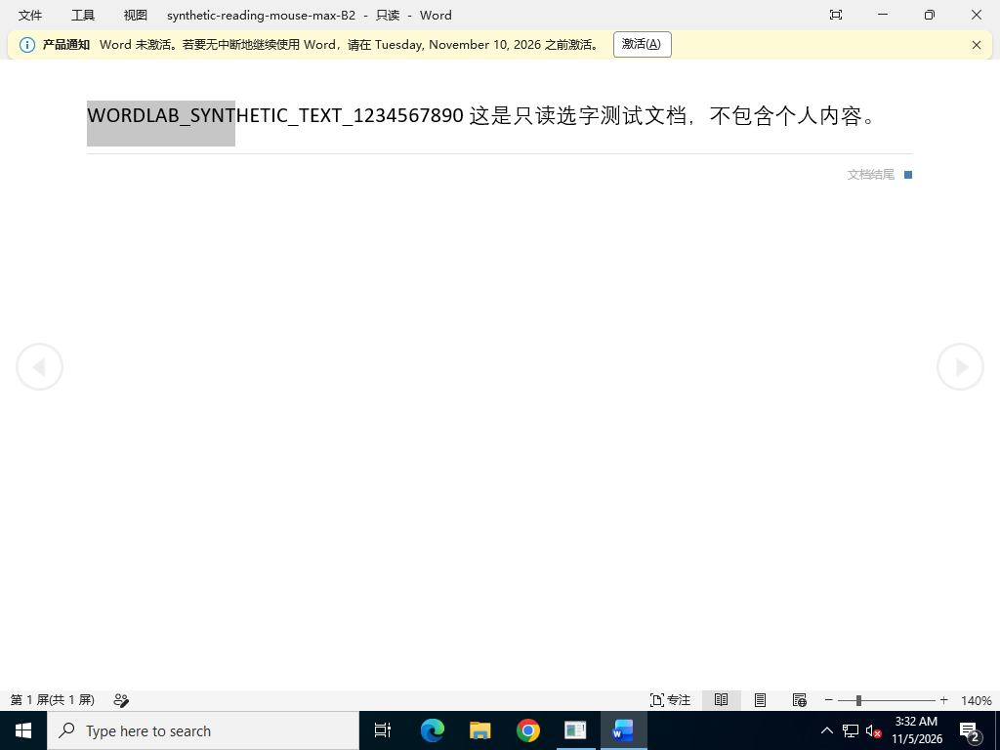
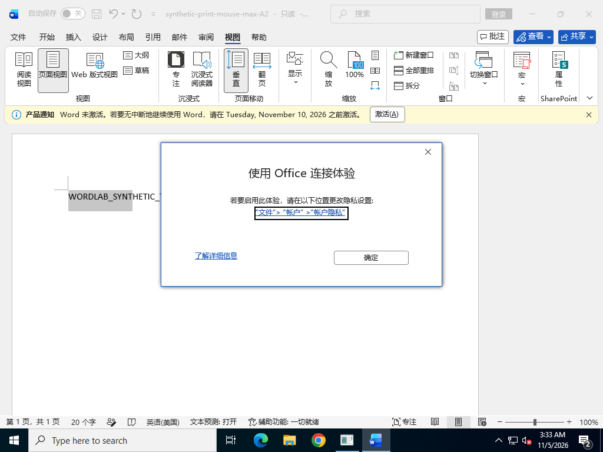

# Word 只读选字弹窗：实测结论 V1.0

**已在真实 Windows Word 复现。已验证的可用操作是：保持文件只读与连接体验关闭，切换到“视图 → 阅读视图”，用鼠标选中文字后 Ctrl+C。页面视图中的原故障仍未根治。**

## 用户操作

| 步骤 | 位置 | 操作 | 结果 |
|---|---|---|---|
| 1 | 本地 Word 文件 | 保留原有只读属性和连接体验关闭状态，打开文件 | 原文件保持只读 |
| 2 | Word“视图”选项卡 | 点击“阅读视图”（部分版本叫“阅读模式”） | 进入 Word 本地阅读布局 |
| 3 | 正文 | 用鼠标拖选文字，按 Ctrl+C | 在本次实测中正常复制且无目标弹窗 |

此操作不更改文件存储路径或 OneDrive 配置。它需要在阅读视图下使用；切回页面视图后，原故障仍可重现。阅读视图的排版与页面视图不同。本次没有验证阅读视图中的键盘 Shift+方向键选字。

## 真实对照结果

测试使用自动生成的合成文档，不含用户内容。在每次选字前确认没有目标弹窗，在选字后等待并检查 UI，同时读取剪贴板确认实际复制了合成文字。

| 状态 | 文件只读属性 | Document.ReadOnly | 选字方式 | 复制内容 | 目标弹窗 |
|---|---|---|---|---|---|
| 页面视图基线 | 是 | — | 键盘 | 被弹窗中断 | 出现 |
| 阅读视图 B | 是 | True | 鼠标 | WORDLAB_SYNT，核验正确 | 未出现 |
| 重启 Word 后阅读视图 B2 | 是 | True | 鼠标 | WORDLAB_SYNT，核验正确 | 未出现 |
| 恢复页面视图 A2 | 是 | True | 鼠标 | 被弹窗中断 | 再次出现 |

四个连接体验禁用策略在整个实验前后均保持为 2，`privacyUnchangedAndDisabled=true`。候选实验覆盖项已全部恢复，成功的阅读视图对照在恢复这些候选之后完成。

- [完整 Actions 运行记录](https://github.com/rocstarliu-crypto/officeword-xml/actions/runs/41961333547)
- [原始结果 JSON](evidence/v1.9/attempt.json)
- [运行次数审计](evidence/v1.9/actions-budget-audit.json)

## 验证范围

- Windows Server 2022，真实 Microsoft 365 家庭版安装产品 O365HomePremRetail，x64，版本 16.0.20326.20232，中文界面。
- 使用官方 Office Deployment Tool 安装并验证微软签名；未提供账号或产品密钥，使用初始激活宽限期内可用的界面与复制功能。
- 未匹配用户的已激活账号、两台原机版本与 OneDrive 登录同步环境，因此不能声称已在用户原机完成修复。
- `attempt.json` 中 `viewFallback.verified=true` 表示阅读视图鼠标复制规避通过；`fixedInTestEnvironment=false` 和 `verifiedValues=null` 表示没有验证出可消除页面视图故障的注册表修复。两者含义不同，原始记录保持不改。
- 实际关闭两种浮动工具栏、直接 EnableCopilot=0、已观察到的实验功能覆盖及组合均未消除页面视图故障，不作为用户修复方案交付。

## Actions 硬性限频

依照用户新要求，后续滚动 60 分钟最多 10 次 Actions。控制器与运行端均保守检查 62 分钟窗口，同时计 workflow 运行数和 job 数，失败/取消/跳过/重跑计入，数据不全则停止启动。该次运行端审计为 6 次流程、6 个任务。

所有实验工作流最终改为仅手动触发，提交报告不会启动测试；不设置自动重试。后续触发必须先遵守 [AGENTS.md](AGENTS.md) 的预算检查。
