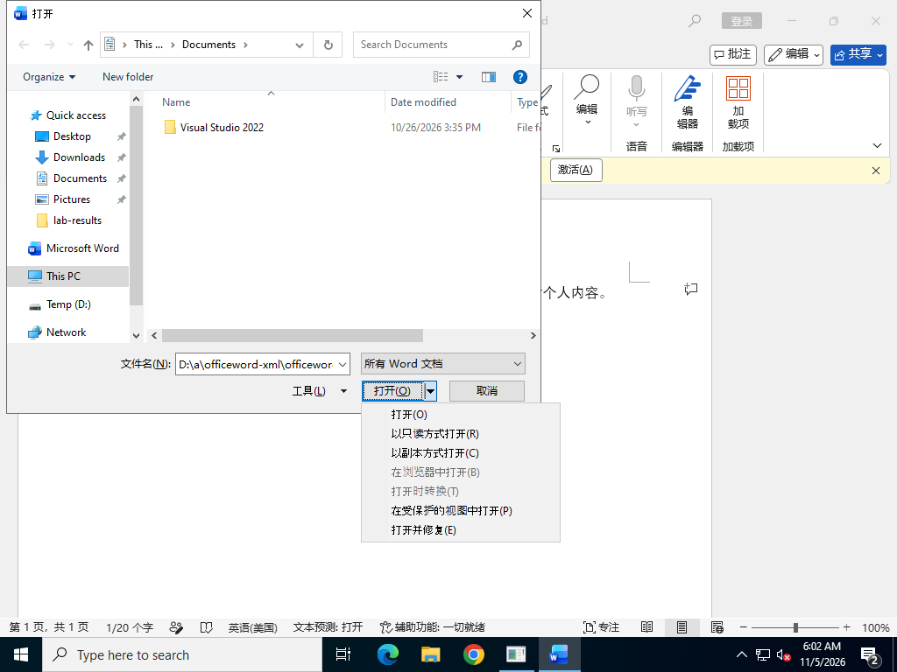
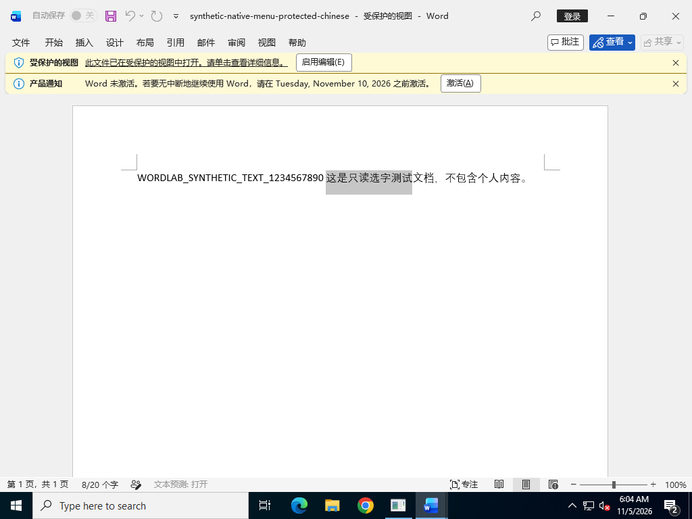
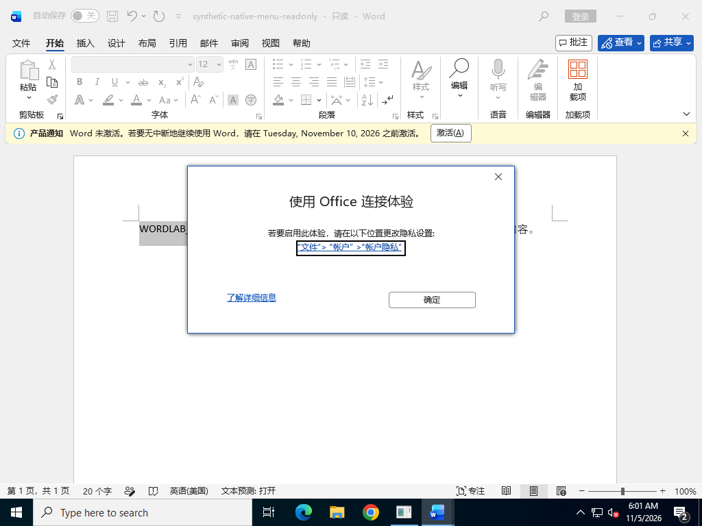

# Word 只读选字弹窗：实测结果 V1.1

日期：2026-11-05。此文件增补 V1.0，旧版保留。

## 结论

**最终采用 Word 自带的“在受保护的视图中打开”。** V3.1 已在真实“打开”下拉菜单中点击该选项，4 组键盘、鼠标、脱敏结构文档及中文选字测试全部复制成功，无“使用 Office 连接体验”弹窗。

4 组均保持：原文件路径、文件属性只读、Word Document.ReadOnly=true、页面视图 View.Type=3、ProtectedViewWindows.Count=1、四项 Office 连接体验策略为 2。原始结果 `evidence/v3.1/attempt.json` 中 `verifiedNativeProtectedMenu=true`。

同一实际菜单中的**“以只读方式打开”仍然触发原弹窗**，不能作为本问题的解决办法。`verifiedNativeReadonlyMenu=false`。打开策略未更改 Office 二进制或资源管理器关联；普通双击原文件的触发缺陷尚未根治。

V2.4 另有 10 组受保护视图实际复制证据。V2.5 的明确 COM ReadOnly 参数也有 7 组实际复制证据，但其便携封装在未登录测试机被首次登录提示阻挡，未通过完整复制验收，不交付为已验证工具。旧实验和失败结果原样保留。

## 环境和验收口径

- GitHub 官方 Windows Server 2022 临时桌面，实际安装并操作中文版 Word。
- 产品 O365HomePremRetail，使用官方 ODT，安装程序验证 Microsoft 数字签名。
- 未向测试环境提供个人微软账号、授权密钥或 OneDrive 凭据。使用安装初期的激活宽限状态；未证明与用户已激活账号完全一致。
- 四项 Office 连接体验策略均为 DWORD 2。每轮记录策略快照并核对未改变。
- 正向对照：普通可写文件可以选字并实际复制。负向对照：普通只读文件在选字后出现与用户截图一致的“使用 Office 连接体验”。
- 普通页面视图候选必须同时满足：同一文件路径、文件属性只读、Word Document.ReadOnly 为真、View.Type=3、无目标弹窗且剪贴板内容与合成选区一致。
- 受保护视图属于另一种打开方式，需单独记录，不称为普通只读打开的根本修复。

## 本轮新增排查

| 实验 | 实际结果 |
|---|---|
| 原文档脱敏结构复现 | 保留 163 段、3 表及格式限制后仍能复现；不是仅纯文本测试出现 |
| 查看状态切换为编辑状态 | 界面切换成功，原文件及 Word 内部仍只读，弹窗仍出现 |
| 关闭实时预览、屏幕提示 | 设置读回确认已关闭，仍出现弹窗；测试后恢复 |
| DisplayAlerts=0 | 仅诊断，仍出现弹窗；不作为用户解决方案 |
| UCI/UXPlatform/Shared 相关候选 | 无效，恢复原值 |
| RestrictSUAToLeftClick 真/假、只读选字 SUA、查看状态相关开关等 8 组 | 全部仍弹窗；8 组均恢复原值 |
| V2.2 受保护视图测试 | 测试脚本的版本号替换损坏下载地址，安装 404 中止；没有得出 UI 结论 |
| V2.3 受保护视图测试 | 同路径、文件及内部只读、页面视图均确认；鼠标未复制，对照也未复制，不计成功 |
| V2.4 受保护视图测试 | 10 组全部复制成功，无目标弹窗；同原路径、双重只读、页面视图 3 |
| V2.5 明确只读参数打开 | 7 组全部通过；原生打开 A2 对照弹窗恢复；verifiedDirectReadonlyOpen=true |
| V2.6 实际便携 ZIP V1.0 | COM RPC_E_DISCONNECTED；工具终验失败，未交付 |
| V2.7 实际便携 ZIP V1.1 | 打开状态通过，验收脚本遗漏窗口恢复，复制未验 |
| V2.8/V2.9 实际便携 ZIP V1.1 | 打开状态通过；复制被测试机登录提示阻挡，不算成功 |
| V3.0 原生菜单定位 | 对话框确实打开，但位于 Word UIA 根的子窗口，定位器漏识别；未点击选项，不算功能失败 |
| V3.1 原生“以只读方式打开” | 实际点击后选字，原弹窗出现；不通过 |
| V3.1 原生“在受保护的视图中打开” | 4/4 实际菜单、选字、复制均通过；原路径、双重只读、页面视图及隐私状态保持 |

## 使用方法

| 步骤 | 操作 |
|---|---|
| 1 | 先关闭需要读取的那份文档，保留 Word 打开；按 Ctrl+F12 调出“打开”窗口 |
| 2 | 选中原来的只读文件，点击右下角“打开”按钮旁的小三角 |
| 3 | 选择“在受保护的视图中打开”，随后正常选字、复制 |

**保持受保护视图，不要点击“启用编辑”。** V2.4 的 ProtectedViewWindow.Edit() 对照在保留文件只读和页面视图时又触发了原弹窗。

文件属性中的“只读”维持原样，不需要启用 Office 连接体验，也不需要修改 OneDrive 设置。本测试没有用户 OneDrive 凭据，未对真实账号的同步作验证；本方法本身不操作同步配置。

这是一种已验证的原生打开方式绕开方法，普通双击的原问题不因此获得永久修复。

原生菜单实拍：

中文选字复制成功实拍：

同次“以只读方式打开”的失败对照：

实验程序仍保留在 solution/，状态见 solution/STATUS.md，不作为已验收产品交付。

## 用户文档与数据

原 DOCX 保持不变。公开测试仓库中只使用合成文字或全部正文脱敏的结构文件，省去源文件元数据与外部链接。原文档正文及原文件没有上传到公开仓库。

## 已验证的上一轮临时办法

V1.9：视图 → 阅读视图，鼠标选字并复制，两次独立启动均通过；切回页面视图后原弹窗恢复。
该办法会改变显示方式，不能称为普通页面视图问题已修复。详见旧版 RESULTS_V1.0.md。

## Actions 限制

每次显式标签触发前，读取仓库最近运行和 job 数，按 62 分钟保守窗口审计；两者最多 10，失败和跳过计入。一次只运行一个实验，无 push、synchronize、定时自动启动或自动重跑。

V2.0 运行 41965624549；V2.1 运行 41966957313；V2.2 失败运行 41968057013；V2.3 运行 41968254740；V2.4 运行 41969049903；V2.5 运行 41970448236；V2.6 运行 41971468736；V2.7 运行 41972539373；V2.8 运行 41973394717；V2.9 运行 41974194630；V3.0 运行 41975909284；最终 V3.1 运行 41977238406，job 127078834091，artifact 13392269107。

测试分支：codex/word-readonly-lab-v1。Draft PR：
https://github.com/rocstarliu-crypto/officeword-xml/pull/1

主分支不合并实验。最终所有实验工作流恢复为仅手动入口，无自动标签、推送或定时触发。

## 微软原始说明

- Explain 选字功能：https://support.microsoft.com/en-us/word/explain-function-in-word-viewing-mode
- 在受保护的视图中打开：https://support.microsoft.com/zh-cn/office/collab-files/what-is-protected-view
- ProtectedViewWindows.Open：https://learn.microsoft.com/en-us/office/vba/api/word.protectedviewwindows.open

微软说明用于确定功能用途及操作入口，是否避开本次弹窗以本仓库实际对照测试为准。
